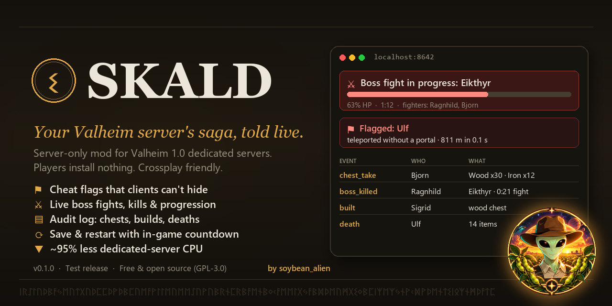

<p align="center"></p>

# Skald: server audit log, boss tracker and cheat flags for Valheim

**Skald is a server-only mod for Valheim 1.0 dedicated servers.** It records what happens on your server, shows it on a web dashboard and helps admins catch cheaters. It also cuts the dedicated server's CPU use by about 95%.

- **Players install nothing.** Unmodded PC players can join, and so can Xbox, PlayStation and Switch players on crossplay servers.
- **It only observes.** It never changes gameplay, loot or the world.
- **It fails safely.** If a Valheim update breaks one of its hooks, only that feature turns off. The server keeps running and players can still join.

> Status: **0.1.0, early test release.** Tested on a Windows dedicated server with Valheim 1.0.17 and
> BepInExPack_Valheim 5.4.2351. Linux servers should work but haven't been tested yet. Please report what you find
> (see [Feedback](#feedback)).

---

## Contents
- [What it does](#what-it-does)
- [Requirements](#requirements)
- [Quick start (TL;DR)](#quick-start-tldr)
- [Guide A: your own Windows PC](#guide-a-host-on-your-own-windows-pc)
- [Guide B: a Linux VPS](#guide-b-linux-vps-rented-server-eg-hetzner-ovh-digitalocean-contabo)
- [Guide C: a Windows VPS](#guide-c-windows-vps)
- [Guide D: game-server hosting with a control panel](#guide-d-game-server-hosts-with-a-control-panel-g-portal-nitrado-host-havoc-)
- [Using the dashboard](#using-the-dashboard)
- [Configuration reference](#configuration-reference)
- [Security notes](#security-notes)
- [Troubleshooting](#troubleshooting)
- [Uninstall](#uninstall)
- [Building from source](#building-from-source)
- [Credits and AI disclosure](#credits-and-ai-disclosure)
- [Feedback](#feedback)

---

## What it does

| Feature | Details |
|---|---|
| **Audit log** | Who took or stored which items in which chest (and who built that chest), who built or removed which pieces, which pieces were destroyed by damage, deaths with full gravestone contents, gravestone looting, and joins and leaves. Every entry has a time and position. |
| **Boss tracker** | A live **"⚔ Boss fight in progress"** banner with HP bar, fight timer, fighters and summoner. Fight history records the outcome, fight time and killing blow. A progression row shows every boss with a check mark once it has been beaten. A world scan finds bosses that were summoned and left alive anywhere. |
| **Cheat flags** | A red ⚑ appears next to a character's name when they use cheats. Skald uses Valheim's own cheat tracking (spawned items, no-cost building, fly mode, god-mode hits) **plus server-side checks a client can't hide from**: cheat-tool fingerprint (Server devcommands), **teleporting** without a portal, and a **boss spawned away from its altar**. Admins can **Dismiss** a flag (it comes back if the player does it again) or **Trust** a player (still recorded, never alerted). |
| **Admin alerts** | When a new flag is raised, online admins get a message in the centre of the screen and in their chat box. You can also send alerts to a **Discord channel** through a webhook. |
| **Save & restart** | A dashboard button that saves the world, warns players with an in-game countdown (10 min → 5 → 2 → 1 → 30 s → 10 → 5-4-3-2-1), shuts down cleanly and starts again. **Save now** and **Cancel** buttons are included. |
| **Lower server CPU use** | Out of the box, the Valheim dedicated server runs uncapped at thousands of frames per second and keeps about 10 CPU cores busy, even with nobody online. Skald caps it at 60 fps by default. In our measurements, CPU use went from **~1000% to ~30–50%** of one core. If you play on the same PC that hosts the server, this greatly reduces in-game stutter. |
| **Overhead you can check** | `GET /api/perf` shows exactly how much server time Skald uses. We measured about 1.4 ms of server time per second of play (≈0.14% of one core). |

---

## Requirements

| What | Version / notes |
|---|---|
| Valheim **dedicated server** | 1.0.x (tested on 1.0.17, network version 40). Steam app **896660**, free for Valheim owners. |
| **BepInExPack_Valheim** | 5.4.2351 or newer, from [Thunderstore](https://thunderstore.io/c/valheim/p/denikson/BepInExPack_Valheim/). Install it **on the server only**. |
| Skald | `Skald.dll` from the [Releases](../../releases) page. |
| Players | **Nothing.** Players with an unmodded game can join, including console players on crossplay. |

Skald does **not** need Jötunn or any other library.

---

## Quick start (TL;DR)

1. Install the **Valheim Dedicated Server**.
2. Copy the contents of **BepInExPack_Valheim** into the server folder.
3. Copy `Skald.dll` to `<server folder>/BepInEx/plugins/Skald/Skald.dll`.
4. Start the server. Look for `Dashboard listening on http://localhost:8642/` in the console.
5. Open **http://localhost:8642** on the server machine.
6. For the admin buttons, paste the token from `BepInEx/config/skald.servermetrics.cfg` (the line `Token = …`) into the Admin box.

The step-by-step guides follow.

---

## Guide A: host on your own Windows PC

Use this guide to run a server for friends from your gaming or home PC.

### A1. Install the dedicated server
1. Open **Steam → Library**. Change the filter dropdown from "Games" so it includes **Tools**.
2. Search for **Valheim Dedicated Server** and install it (about 2 GB). Alternatively, paste
   `steam://install/896660` into your browser.
3. Find its folder: right-click it in Steam → **Manage → Browse local files**. It is usually
   `C:\Program Files (x86)\Steam\steamapps\common\Valheim dedicated server`.
   This folder is called **`<server>`** in the rest of the guide.

### A2. Install BepInEx (the mod loader) on the server
1. Download **BepInExPack_Valheim** from
   [Thunderstore](https://thunderstore.io/c/valheim/p/denikson/BepInExPack_Valheim/) with the **Manual Download** button.
2. Open the zip. Inside is a folder named **`BepInExPack_Valheim`**.
3. Copy **everything inside** that folder into `<server>`. Don't copy the folder itself. Afterwards `<server>` should contain:
   ```
   <server>\BepInEx\
   <server>\doorstop_config.ini
   <server>\winhttp.dll
   <server>\valheim_server.exe        (already there)
   ```
   On Windows, `winhttp.dll` makes BepInEx load automatically. You don't need a special launcher.

### A3. Install Skald
1. Download `Skald-<version>.zip` from [Releases](../../releases).
2. Unzip it. Copy **`Skald.dll`** to:
   ```
   <server>\BepInEx\plugins\Skald\Skald.dll
   ```
   If the `plugins\Skald` folder doesn't exist, create it.

### A4. Create your start script
Steam overwrites `start_headless_server.bat` on updates, so make your own copy:
1. In `<server>`, copy `start_headless_server.bat` and name the copy **`start_my_server.bat`**.
2. Right-click it → **Edit**. Replace the last line with this, using your own values:
   ```bat
   @echo off
   set SteamAppId=892970
   cd /d "%~dp0"
   "%~dp0valheim_server.exe" -nographics -batchmode -name "My Viking Server" -port 2456 -world "MyWorld" -password "change-me-123" -public 1
   ```
   - The `password` must be at least 5 characters and must not contain the server name.
   - Use `-public 0` to keep it off the in-game server list. Friends can still join by IP.
   - Add `-crossplay` if Xbox, PlayStation or Switch players need to join.
   - Use `"%~dp0valheim_server.exe"` (the full path) exactly as shown. Some shells refuse to run a bare `valheim_server`.
3. Save, then **double-click `start_my_server.bat`**. A console window opens.

### A5. Check that it works
In the console, within about a minute, you should see:
```
[Info   :   BepInEx] Loading [Skald 0.1.0] (skald.servermetrics)
[Info   :     Skald] Collector enabled: ZdoDataPatches
...
[Info   :     Skald] Dashboard listening on http://localhost:8642/
[Info   :     Skald] Server frame rate capped at 60 fps (config [Performance] ServerFrameRateCap).
... Opened Steam server
```
The console window's title changes to **`Valheim Server (Skald) - MyWorld :2456`**.

### A6. Make yourself an admin (for alerts and console commands)
1. Find your **SteamID64**. It's the 17-digit number on your Steam profile URL, or use a site such as steamid.io.
2. Open the admin list in the save folder:
   `%USERPROFILE%\AppData\LocalLow\IronGate\Valheim\adminlist.txt`
   (If you used `-savedir`, it's in that folder instead.)
3. Add your SteamID64 on its own line, save, and restart the server to be sure it's picked up.

### A7. Let friends connect
- **On your network:** they use **Join IP → `<your PC's LAN IP>:2456`**. Run `ipconfig` to find your LAN IP.
- **Over the internet:** forward **UDP 2456–2458** on your router to your PC, or use `-public 1` and let them find it in the server list.
- **When Windows Firewall asks** about `valheim_server.exe`, allow it. Private networks are enough for LAN; tick Public too for internet players.
- **To join from the same PC:** **Join IP → `127.0.0.1:2456`**.

### A8. Open the dashboard
- On the PC running the server, go to **http://localhost:8642**.
- For the admin buttons (Save now, Save & restart, Dismiss, Trust):
  1. Open `<server>\BepInEx\config\skald.servermetrics.cfg`.
  2. Copy the value after `Token = `.
  3. Paste it into the **Admin** box at the top of the dashboard. Your browser remembers it.

### A9. Stopping the server safely
- Click the server console window and press **Ctrl+C**. That saves the world and shuts down cleanly.
- Closing the window with the **X** does **not** save.
- From the dashboard, **Save & restart** saves and restarts by itself. On Windows the restarted server opens in a new console window.

---

## Guide B: Linux VPS (rented server, e.g. Hetzner, OVH, DigitalOcean, Contabo)

> ⚠️ Skald 0.1.0 has **not been tested on Linux yet**. The steps below follow the standard Valheim + BepInEx
> Linux setup. Please open an issue with your results.

**Recommended size:** 2–4 vCPU and 4–8 GB RAM for 2–10 players. Valheim needs more RAM as the world grows.
The examples use Ubuntu 24.04 and a user named `valheim`.

### B1. Prepare the machine (run as root or with sudo)
```bash
sudo dpkg --add-architecture i386
sudo apt update
sudo apt install -y steamcmd unzip curl libpulse0 libatomic1 libc6
sudo useradd -m -s /bin/bash valheim
```
On Debian/Ubuntu, `steamcmd` asks you to accept the Steam license during install.

### B2. Install the Valheim dedicated server
```bash
sudo -iu valheim
steamcmd +force_install_dir /home/valheim/server +login anonymous +app_update 896660 validate +quit
```
Run the same command again later to **update** the server when Valheim patches.

### B3. Install BepInEx
```bash
cd /home/valheim
curl -L -o bepinex.zip "https://thunderstore.io/package/download/denikson/BepInExPack_Valheim/5.4.2351/"
unzip -o bepinex.zip -d bepinex_pkg
cp -r bepinex_pkg/BepInExPack_Valheim/* /home/valheim/server/
chmod +x /home/valheim/server/start_server_bepinex.sh
```
On Linux, BepInEx is loaded by **`start_server_bepinex.sh`**. Always start the server with this script, not by running the binary directly.

### B4. Install Skald
```bash
mkdir -p /home/valheim/server/BepInEx/plugins/Skald
# upload Skald.dll from the release zip to the VPS (e.g. with scp from your PC):
#   scp Skald.dll valheim@YOUR_VPS_IP:/home/valheim/server/BepInEx/plugins/Skald/
```

### B5. Configure the start script
Edit `/home/valheim/server/start_server_bepinex.sh`. Near the bottom is a line that launches
`valheim_server.x86_64`. Set your values on it:
```bash
"${VALHEIM_PLAY}" -nographics -batchmode -name "My Viking Server" -port 2456 -world "MyWorld" -password "change-me-123" -public 1
```
(Variable names differ slightly between BepInExPack versions. Keep the script's own launch line and change only the arguments.)

### B6. Open the firewall
```bash
sudo ufw allow 2456:2458/udp     # game traffic
sudo ufw allow OpenSSH           # keep SSH working!
sudo ufw enable
```
Don't open the dashboard port (8642) to the internet. See B9 for safe ways to view it.

### B7. Run it as a service (auto-start and auto-restart)
On Linux, Skald's **Save & restart** button saves and shuts the server down, then lets systemd start it again.
Create `/etc/systemd/system/valheim.service`:
```ini
[Unit]
Description=Valheim dedicated server (with Skald)
After=network-online.target
Wants=network-online.target

[Service]
User=valheim
WorkingDirectory=/home/valheim/server
ExecStart=/home/valheim/server/start_server_bepinex.sh
Restart=always
RestartSec=10
KillSignal=SIGINT
TimeoutStopSec=120

[Install]
WantedBy=multi-user.target
```
`KillSignal=SIGINT` acts like Ctrl+C, so the world is saved when you stop the service.
```bash
sudo systemctl daemon-reload
sudo systemctl enable --now valheim
journalctl -u valheim -f            # live console; Ctrl+C here only stops viewing
```
Look for `Dashboard listening on http://localhost:8642/` and `Opened Steam server`.
The full log is in `/home/valheim/server/BepInEx/LogOutput.log`.

### B8. Make yourself an admin
Add your SteamID64 on its own line to the admin list:
```bash
echo "76561198000000000" >> /home/valheim/.config/unity3d/IronGate/Valheim/adminlist.txt
```
(On Linux the save folder is `~/.config/unity3d/IronGate/Valheim/`, unless you used `-savedir`.)

### B9. View the dashboard from your own PC (safe options)
By default the dashboard only listens on the VPS itself (`localhost`). This is deliberate, because the dashboard uses plain HTTP.

**Option 1 (recommended): SSH tunnel.** You need nothing else, and traffic is encrypted.
Run this on **your PC** (Windows PowerShell, macOS or Linux):
```bash
ssh -N -L 8642:localhost:8642 valheim@YOUR_VPS_IP
```
Leave it running and open **http://localhost:8642** in your browser.

**Option 2: HTTPS reverse proxy** (to share a read-only view with your players). Install
[Caddy](https://caddyserver.com) and point a domain at the VPS. In `/etc/caddy/Caddyfile`:
```
skald.example.com {
    reverse_proxy localhost:8642
}
```
`sudo ufw allow 80,443/tcp`, then reload Caddy. Caddy gets a free HTTPS certificate automatically.
⚠️ Anyone with the URL can **view** the log, but only people with the admin token can **press admin buttons**.
Built-in viewer logins are on the roadmap.

---

## Guide C: Windows VPS

Follow **Guide A**, with these changes:
1. Connect with **Remote Desktop**. There's no Steam client on a VPS, so install the server with **SteamCMD**:
   ```powershell
   mkdir C:\steamcmd; cd C:\steamcmd
   Invoke-WebRequest https://steamcdn-a.akamaihd.net/client/installer/steamcmd.zip -OutFile steamcmd.zip
   Expand-Archive steamcmd.zip .
   .\steamcmd.exe +force_install_dir C:\valheim +login anonymous +app_update 896660 validate +quit
   ```
   `C:\valheim` is your `<server>` folder.
2. Do steps **A2 to A6** in `C:\valheim`.
3. Open the ports in Windows Firewall:
   ```powershell
   New-NetFirewallRule -DisplayName "Valheim" -Direction Inbound -Protocol UDP -LocalPort 2456-2458 -Action Allow
   ```
   Also check your VPS provider's firewall or security group, if it has one.
4. Restarting works the same as on a desktop: **Save & restart** relaunches the server in a new console window.
   To start the server after a VPS reboot, add `start_my_server.bat` to **Task Scheduler** with the trigger "At startup",
   running as your user.
5. View the dashboard over an SSH tunnel (Windows Server includes OpenSSH Server, which you can enable) or
   through an HTTPS reverse proxy such as Caddy for Windows. See **B9**.

---

## Guide D: game-server hosts with a control panel (G-Portal, Nitrado, Host Havoc, …)

Most panels have a **BepInEx / Mods** switch or a "Valheim Plus/BepInEx" version selector.
1. In the panel, **enable BepInEx** (or install BepInExPack_Valheim with the host's mod installer), then restart once
   so the `BepInEx` folders are created.
2. Connect with the panel's **File Manager** or **FTP/SFTP**. Upload `Skald.dll` to:
   ```
   BepInEx/plugins/Skald/Skald.dll
   ```
3. Restart from the panel. In the panel's console or log, check for `Loading [Skald ...]`.
4. **Dashboard:** panel hosts usually don't expose extra ports. Ask your host whether you can open **one extra TCP
   port**, then set `Port` to it and `Bind = *` in `BepInEx/config/skald.servermetrics.cfg`. ⚠️ Read
   [Security notes](#security-notes) first: it's plain HTTP.
5. **Restarts:** set `RestartMode = exit` in the config. The panel's watchdog then brings the server back after
   **Save & restart**. Most panels restart crashed or stopped servers automatically; check your host's docs.
6. The audit log, boss tracking, cheat flags, alerts and the CPU cap all work without the dashboard port.

---

## Using the dashboard

Open **http://localhost:8642** (or your tunnel or proxy address).

- **Admin box:** paste the admin token here. Admin-only buttons appear only while a valid token is in the box.
  - **Save now:** saves the world immediately and tells players "World saved."
  - **Save & restart** (Now / 1 / 5 / 10 minutes): saves, counts down for players and restarts. **Cancel restart** stops the countdown.
- **⚑ Flagged players:** each player is listed with their reasons, how many times each happened, when it last happened and an example.
  The red panel turns grey when only trusted players are left.
  - **Dismiss** hides one reason until the player does it again. **Dismiss all** hides all of a player's reasons.
  - **Trust (known admin)** keeps recording the player's flags but never alerts. **Untrust** reverses it.
- **Bosses:** the progression chips, a live fight banner (red while fighting; amber "alive, nobody fighting") and the fight history.
- **Event log:** newest first. Filter it with the **Show** dropdown, e.g. `chest_take`, `cheat_flag` or `boss_killed`.

**JSON API** (read-only unless noted):

| Endpoint | Returns |
|---|---|
| `GET /api/events` | The last 500 events |
| `GET /api/bosses` | Active fights, fight history and progression |
| `GET /api/flags` | Flagged players and their reasons |
| `GET /api/status` | Restart countdown state |
| `GET /api/perf` | Skald's cost per hook and job, slow server frames, recent requests |
| `POST /api/admin/save` · `restart?delay=N` · `cancel` · `dismiss?player=&reason=` · `trust?player=&on=1\|0` | Admin actions. Requires the header `X-Skald-Token: <token>` |

Data files (in `BepInEx/skald/`): `events.jsonl` (the audit log, append-only), `bosses.jsonl`, `flags.tsv`, `trusted.txt`.

---

## Configuration reference
File: `BepInEx/config/skald.servermetrics.cfg`. It's created the first time the server starts. Edit it, then restart the server.

| Section | Key | Default | What it does |
|---|---|---|---|
| Web | `Port` | `8642` | Dashboard port (TCP). |
| Web | `Bind` | `localhost` | `localhost` = only this machine can open the dashboard. `*` = any machine (read the security notes first). |
| Admin | `Token` | *(generated)* | Secret for the admin buttons. To get a new one, delete the value and restart. |
| Admin | `RestartMode` | `relaunch` on Windows, `exit` elsewhere | `relaunch`: Skald starts the server again itself. `exit`: it only shuts down, and systemd, Docker or your panel restarts it. |
| Admin | `RestartCommand` | *(empty)* | A custom command to start the server again, e.g. `./start_server_bepinex.sh`. |
| Console | `Title` | `Valheim Server (Skald) - {world} :{port}` | The server console window title (Windows). Empty = leave it as is. |
| Flags | `IgnoreAdmins` | `false` | `true` = never flag players on the admin list. |
| Alerts | `InGame` | `true` | Alert online admins in-game when there's a new flag. |
| Alerts | `InGameStyle` | `center` | `center` · `topleft` · `none`. The F5 console covers the top-left corner. |
| Alerts | `InChat` | `true` | Also put the alert in admins' chat box. It stays in chat history. |
| Alerts | `DiscordWebhook` | *(empty)* | Discord webhook URL for flag alerts. **Keep it secret.** |
| Performance | `ServerFrameRateCap` | `60` | Caps the server's frame rate. `0` = vanilla (uncapped, burns many CPU cores). |

---

## Security notes
- The dashboard is **plain HTTP** with no viewer login yet. By default it only listens on the server itself (`localhost`).
- The **admin token** is sent in a request header. Over plain HTTP on the internet, it could be read by someone in between. Use an **SSH tunnel** or an **HTTPS reverse proxy** for remote access. Avoid `Bind = *` on a public IP without HTTPS.
- The event log contains **player names, SteamIDs and positions** (including base locations). Don't make it public without telling your players.
- Never share `skald.servermetrics.cfg`. It contains your admin token and Discord webhook.

---

## Troubleshooting

| Symptom | Fix |
|---|---|
| No `Loading [Skald …]` line | Check that BepInEx is installed. You should see `BepInEx 5.4.x` at the top of the console and a `BepInEx/LogOutput.log` file. On Linux, start the server with `start_server_bepinex.sh`. Check the DLL path: `BepInEx/plugins/Skald/Skald.dll`. |
| `Dashboard disabled, could not listen on …` | Another program is using the port. Change `[Web] Port`. If you set `Bind = *` and other machines still can't connect, allow that TCP port in the firewall. |
| `Collector disabled: <name>` | A Valheim update changed something Skald hooks. That feature is off and everything else still works. Please open an issue with the log. |
| Dashboard opens but admin buttons are missing | Paste the token into the Admin box. The buttons only appear when a token is entered. |
| "Refused: wrong or missing admin token" | Copy the `Token = …` value again from the cfg, without spaces. |
| **Save & restart** shut the server down but it didn't come back | Windows: see `%TEMP%\skald_relaunch.log`. Linux and panels: set `RestartMode = exit` and let systemd or your panel restart the server. |
| Players rubber-band after installing | Try `ServerFrameRateCap = 120` or `0` and report it. 60 fps was smooth in testing. |
| Where are the logs? | `BepInEx/LogOutput.log` in the server folder. Skald's lines start with `[Info : Skald]`. |

---

## Uninstall
1. Stop the server.
2. Delete `BepInEx/plugins/Skald/`.
3. Optionally, also delete `BepInEx/config/skald.servermetrics.cfg` and the `BepInEx/skald/` data folder.

Skald doesn't change your world save, so removing it is safe.

---

## Building from source
Requirements: .NET SDK 8+, plus a dedicated server with BepInEx installed (for the reference DLLs).
```bash
cd Skald
dotnet build -c Release -p:ValheimServerDir="C:\path\to\Valheim dedicated server"
# optional: also copy the DLL into that server's BepInEx/plugins/Skald/
dotnet build -c Release -p:ValheimServerDir="C:\path\to\Valheim dedicated server" -p:DeployToLab=true
```
`tools/FrameProbe` is a **test-only client plugin** that logs game-client frame hitches with timestamps. It's useful for performance investigations and isn't part of the release.

No game files or decompiled game code are included in this repository.

---

## Credits and AI disclosure
- Made by **soybean_alien**. Licensed under the **GNU GPL v3.0** (see [LICENSE](LICENSE)).
- [BepInEx](https://github.com/BepInEx/BepInEx) and [HarmonyX](https://github.com/BepInEx/HarmonyX). Skald is a BepInEx 5 plugin.
- [BepInExPack_Valheim](https://thunderstore.io/c/valheim/p/denikson/BepInExPack_Valheim/) by denikson and maintainers.
- Valheim © Iron Gate AB. Skald is an unofficial fan project and isn't affiliated with Iron Gate or Coffee Stain.
- **AI disclosure:** Skald was designed with and written by **Claude Code (Anthropic, Claude Opus 5.5)**, directed and play-tested by the author, using the universal-modder toolkit. Every feature listed above was tested in-game on a real dedicated server before release.

## Feedback
This is an early test release, and your reports shape what comes next. Please open an issue and include:
- your setup (Windows desktop, Linux VPS, Windows VPS or the name of your hosting panel), player count and world age;
- what worked, what didn't, and `BepInEx/LogOutput.log` (remove any secrets first);
- the output of `/api/perf` if you saw any performance problems.

**On the roadmap:** viewer logins (link codes in game chat), a server health timeline, a settlement census (counting real enclosed buildings), deeper stats and leaderboards, and Thunderstore packaging.
